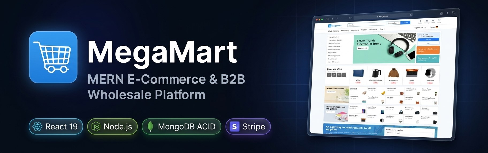
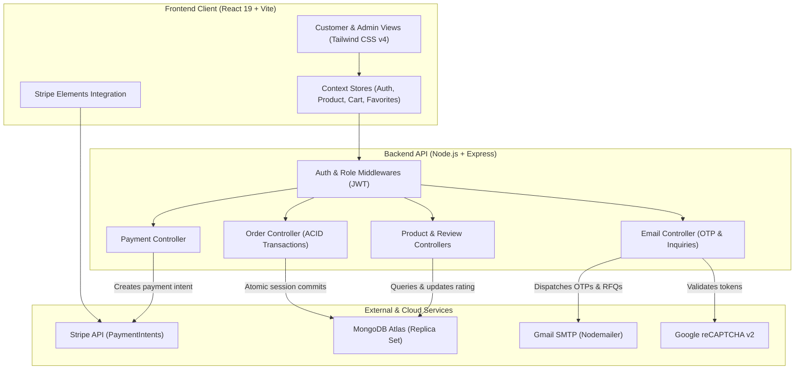

# MERN E-Commerce & B2B Wholesale Platform

<div align="center">



<p align="center">
  <a href="https://react.dev/"></a>
  <a href="https://vite.dev/"></a>
  <a href="https://tailwindcss.com/"></a>
  <a href="https://nodejs.org/"></a>
  <a href="https://expressjs.com/"></a>
  <a href="https://www.mongodb.com/atlas"></a>
  <a href="https://stripe.com/"></a>
  <a href="./LICENSE"></a>
</p>

<p align="center">
  <strong>A full-stack e-commerce and B2B wholesale platform built with React 19, Express, MongoDB, and Stripe.</strong>
  <br />
  Featuring multi-tiered bulk pricing, ACID-compliant transactional order fulfillment, automated email OTP verification, and an administrative console.
</p>

[System Architecture](#system-architecture) • [Key Features](#key-features) • [Tech Stack](#tech-stack) • [Getting Started](#getting-started) • [API Reference](#api-endpoints-summary)

</div>

---

## Overview

This repository contains a full-stack e-commerce and B2B wholesale marketplace application built with the MERN stack (MongoDB, Express, React, Node.js).

The platform supports both retail shopping for individual consumers and wholesale purchasing for commercial buyers. Key features include volume-based tiered bulk pricing, multi-document ACID transactions for checkout consistency, Stripe payment processing, automated email OTP identity verification with MongoDB TTL indexes, verified customer reviews, and a dedicated role-based administration dashboard.

> **Live Demo:** [ecommerce-fullstack-website.vercel.app](https://ecommerce-fullstack-website.vercel.app/)

---

## System Architecture

The application uses a decoupled client-server architecture. The React single-page frontend communicates with an Express REST API backend over HTTPS.



---

## Key Features

### 1. Dual Retail & B2B Wholesale Pricing

- Multi-tiered wholesale pricing bands configured per product (`bulkPricing: [{ minQuantity, maxQuantity, price }]`).
- Cart calculations evaluate unit price brackets automatically as buyers scale quantities.
- Supports Requests for Quote (RFQ) inquiries with quantity and packaging unit selection.

### 2. Transactional Order Fulfillment (ACID Compliance)

- Order placement and stock decrements are encapsulated within native MongoDB multi-document transactions using `mongoose.startSession()`.
- Guarantees atomic verification of available stock thresholds before confirming purchases.
- Automatically rolls back writes if inventory is depleted or validation fails, preventing overselling and race conditions.

### 3. Stripe Payment Integration

- Tokenized credit card checkout utilizing `@stripe/react-stripe-js` CardElement.
- Backend PaymentIntent generation with amount normalization in integer cents to eliminate floating-point calculation errors.

### 4. Automated Email OTP Verification

- Six-digit numeric OTP generation sent through Nodemailer using Gmail SMTP.
- Stored in a dedicated MongoDB collection with a 5-minute TTL index (`expires: 0`) for automated document cleanup.
- Enforces a 60-second cooldown rate limit between consecutive code requests.
- Required identity gate before an authenticated user can place orders.

### 5. Multi-Criteria Faceted Search & Catalog Filtering

- Client-side search and filtering across categories, price range sliders, minimum star ratings, and verified supplier flags.
- Dual layout support allowing buyers to toggle between a 3-column grid view and an itemized list view.
- Pagination controls with customizable page sizes.

### 6. Verified-Purchase Review System

- Enforces reviews exclusively for users who purchased the item in an order marked as `delivered`.
- Protected by a partial unique compound index (`{ product: 1, user: 1, order: 1 }`) to block duplicate feedback.
- Automatically recalculates the product's running average star rating and review count on every submission.

### 7. Role-Based Administration Console

- Admin-exclusive route protection requiring valid JWT payload and `isAdmin: true` credentials.
- Product inventory management including creation, modification, image link binding, and deletion.
- Order fulfillment pipeline using MongoDB aggregation queries (`$lookup`, `$match`, `$sort`, `$facet`) with status progression across `pending`, `approved`, `shipped`, `delivered`, and `cancelled`.

### 8. Multi-Language Support (i18n Bridge)

- Headless integration with the Google Translate engine.
- Custom select components trigger synthetic change events against DOM elements without breaking React hydration.
- Covers English, Arabic, Urdu, Hindi, Bengali, French, and Spanish.

### 9. Resource-Efficient Backend Lifecycle

- Automatic database disconnect after 2 minutes of idle traffic to eliminate persistent MongoDB background heartbeats.
- Allows container environments (such as Railway Serverless) to scale to zero when idle, preserving hosting compute credits.
- Express middleware reconnects to MongoDB on demand when incoming HTTP requests arrive.

---

## Tech Stack

| Layer    | Technology       | Version       | Purpose                                             |
| :------- | :--------------- | :------------ | :-------------------------------------------------- |
| Frontend | React            | 19.0.0        | User interface and component state                  |
| Frontend | Vite             | 6.2.0         | Development server and build tooling                |
| Frontend | Tailwind CSS     | 4.1.4         | Responsive utility-based styling                    |
| Frontend | React Router DOM | 7.3.0         | Client-side routing and protected routes            |
| Frontend | Stripe Elements  | 3.6.0         | Embedded credit card payment inputs                 |
| Frontend | Formik & Yup     | 2.4.6 / 1.6.1 | Form validation schema enforcement                  |
| Frontend | Framer Motion    | 12.7.4        | Layout animations and transition effects            |
| Backend  | Node.js          | 20+           | Server JavaScript runtime                           |
| Backend  | Express          | 4.21.2        | RESTful API framework and routing                   |
| Backend  | Mongoose         | 8.12.1        | MongoDB object data modeling and transactions       |
| Backend  | JSON Web Token   | 9.0.2         | Stateless bearer authentication                     |
| Backend  | BcryptJS         | 3.0.2         | Password hashing with salt                          |
| Backend  | Stripe SDK       | 18.0.0        | Server-side PaymentIntent handling                  |
| Backend  | Nodemailer       | 7.0.3         | Transactional email and OTP dispatch                |
| Database | MongoDB Atlas    | 8.0+          | Cloud database with replica set transaction support |

---

## Repository Structure

```text
ecommerce-fullstack-design/
├── backend/
│   ├── src/
│   │   ├── config/
│   │   │   ├── corsOptions.js          # CORS domain allowlist
│   │   │   └── db.js                   # Mongoose connection & idle timeout manager
│   │   ├── controllers/
│   │   │   ├── cartController.js       # Shopping cart operations
│   │   │   ├── emailController.js      # OTP verification & supplier inquiries
│   │   │   ├── favoriteController.js   # User wishlist management
│   │   │   ├── orderController.js      # Transactional order placement & fulfillment
│   │   │   ├── paymentController.js    # Stripe PaymentIntent creation
│   │   │   ├── recaptchaController.js  # Google reCAPTCHA validation
│   │   │   └── reviewController.js     # Verified review submissions & rating updates
│   │   ├── middleware/
│   │   │   ├── adminMiddleware.js      # Admin authorization guard
│   │   │   └── authMiddleware.js       # JWT extraction and validation
│   │   ├── models/
│   │   │   ├── cart.js
│   │   │   ├── emailOtp.js             # OTP schema with TTL index
│   │   │   ├── favorite.js
│   │   │   ├── order.js
│   │   │   ├── product.js              # Product schema with bulk pricing
│   │   │   ├── review.js               # Review schema with partial index
│   │   │   └── user.js
│   │   ├── routes/                     # Modular Express route declarations
│   │   ├── utils/                      # Arithmetic rating recalculation helper
│   │   └── server.js                   # Express application entry point
│   ├── insertProducts.js               # Catalog seeding script
│   └── package.json
├── src/
│   ├── assets/                         # Static image assets and icons
│   ├── components/                     # Reusable UI components
│   │   ├── PageLoader.jsx              # Centered wake-up state loader
│   │   ├── StripeCheckoutForm.jsx      # CardElement submission form
│   │   ├── SidebarFilter.jsx           # Catalog faceted filter controls
│   │   └── ...
│   ├── context/                        # React Context domain state providers
│   │   ├── AuthContext.jsx
│   │   ├── CartContext.jsx
│   │   ├── FavoritesContext.jsx
│   │   └── ProductContext.jsx
│   ├── pages/                          # Customer and admin route views
│   │   ├── Mainpage.jsx
│   │   ├── ProductPage.jsx
│   │   ├── SearchPage.jsx
│   │   ├── CartCheckout.jsx
│   │   ├── AdminOrdersPage.jsx
│   │   └── ...
│   ├── routes/                         # Route definition & route guards
│   ├── App.jsx
│   ├── main.jsx
│   └── index.css
├── index.html
├── package.json
└── vite.config.js
```

---

## Environment Configuration

The application requires environment configurations for both the frontend client and the backend server.

### 1. Frontend Environment (`.env` in root directory)

```bash
# Backend REST API Base URL
VITE_API_BASE_URL=http://localhost:5000

# Stripe Publishable Key (pk_test_...)
VITE_STRIPE_PUBLISHABLE_KEY=your_stripe_publishable_key

# Google reCAPTCHA v2 Site Key
VITE_RECAPTCHA_SITE_KEY=your_recaptcha_site_key
```

### 2. Backend Environment (`backend/.env`)

```bash
# Server Port
PORT=5000

# MongoDB Atlas Connection URI (Must support replica set for ACID transactions)
MONGO_URI=mongodb+srv://<username>:<password>@cluster0.mongodb.net/ecommerce?retryWrites=true&w=majority

# JWT Signing Secret
JWT_SECRET=your_jwt_secret_key

# Stripe Secret Key (sk_test_...)
STRIPE_SECRET_KEY=your_stripe_secret_key

# Google reCAPTCHA v2 Secret Key
RECAPTCHA_SECRET_KEY=your_recaptcha_secret_key

# Gmail SMTP Credentials for OTP & Inquiries
GMAIL_USER=your_email@gmail.com
GMAIL_PASS=your_google_app_password
COMPANY_EMAIL=your_email@gmail.com
```

---

## Getting Started

### Prerequisites

- Node.js version 20.0.0 or higher
- npm version 9.0.0 or higher
- A MongoDB Atlas cluster (replica set required for transactional checkouts)
- A Stripe developer account for test keys

### 1. Clone the Repository

```bash
git clone https://github.com/bilalzulfiqar-pk/mern-fullstack-ecommerce-app.git
cd mern-fullstack-ecommerce-app
```

### 2. Install Dependencies

Install root (frontend) dependencies:

```bash
npm install
```

Install backend dependencies:

```bash
cd backend
npm install
cd ..
```

### 3. Seed Initial Products (Optional)

To populate the database with starter catalog items:

```bash
cd backend
npm run insert
cd ..
```

### 4. Start Development Servers

Start the backend API server:

```bash
cd backend
npm run dev
```

The backend initializes on `http://localhost:5000`.

In a separate terminal window, start the frontend Vite server:

```bash
npm run dev
```

The frontend application will be accessible at `http://localhost:5173`.

---

## API Endpoints Summary

| Method   | Endpoint                              | Protection | Description                               |
| :------- | :------------------------------------ | :--------- | :---------------------------------------- |
| `POST`   | `/api/auth/register`                  | Public     | Register new customer account             |
| `POST`   | `/api/auth/login`                     | Public     | Authenticate user and return JWT          |
| `GET`    | `/api/auth/user`                      | User JWT   | Retrieve authenticated user profile       |
| `GET`    | `/api/products`                       | Public     | Fetch all catalog products                |
| `POST`   | `/api/products`                       | Admin JWT  | Create new product with bulk pricing      |
| `PUT`    | `/api/products/:id`                   | Admin JWT  | Update product specifications and stock   |
| `DELETE` | `/api/products/:id`                   | Admin JWT  | Remove product from catalog               |
| `GET`    | `/api/cart`                           | User JWT   | Fetch user shopping cart                  |
| `PATCH`  | `/api/cart/add`                       | User JWT   | Add product to cart or increment quantity |
| `DELETE` | `/api/cart/:productId`                | User JWT   | Remove product from cart                  |
| `POST`   | `/api/payments/create-payment-intent` | User JWT   | Initialize Stripe PaymentIntent           |
| `POST`   | `/api/orders/place-order`             | User JWT   | Execute transactional order placement     |
| `GET`    | `/api/orders/my-orders`               | User JWT   | Fetch order history for logged-in user    |
| `GET`    | `/api/orders`                         | Admin JWT  | Fetch paginated orders across all users   |
| `PATCH`  | `/api/orders/:orderId/status`         | Admin JWT  | Update order lifecycle status             |
| `POST`   | `/api/reviews`                        | User JWT   | Submit verified product review            |
| `POST`   | `/api/email/send-verification-otp`    | User JWT   | Send 6-digit email verification OTP       |
| `POST`   | `/api/email/verify-otp`               | User JWT   | Validate OTP and mark email verified      |
| `POST`   | `/api/email/inquiry`                  | Public     | Submit B2B quotation inquiry              |

---

## License

This project is licensed under the MIT License. See the [LICENSE](./LICENSE) file for complete details.
